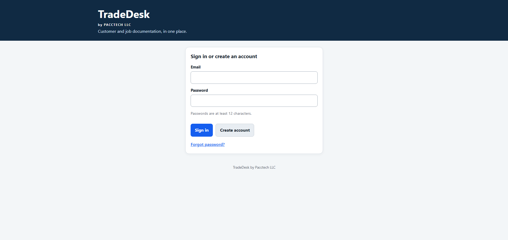

<div align="center">
  
</div>
<h1 align="center">TradeDesk</h1>
<p align="center">
  Job documentation for independent tradespeople
</p>
<p align="center">
  <a href="https://github.com/hmdevio/tradedesk/actions/workflows/ci.yml"></a>
</p>



TradeDesk gives electricians, plumbers, HVAC technicians, carpenters, welders and mechanics one place to organize their jobs and document their work, without generic paperwork. Each job gets a trade-specific worksheet, sketches and notes, and turns into a professional PDF service report the customer can keep.

## Features

- Customers and jobs with status tracking
- Trade-specific worksheets for six trades
- Sketch and photo uploads for each job
- Service reports with review, approval and branded PDF export
- Follow-up tasks with due dates
- Secure accounts with email verification and password reset

## Built with

- [Python](https://www.python.org/) and [FastAPI](https://fastapi.tiangolo.com/)
- [PostgreSQL](https://www.postgresql.org/) with [SQLAlchemy](https://www.sqlalchemy.org/) and [Alembic](https://alembic.sqlalchemy.org/)
- [ReportLab](https://www.reportlab.com/) for PDF reports
- HTML, CSS and JavaScript, with no third-party scripts
- [pytest](https://pytest.org/) and GitHub Actions for automated testing

## Local development

1. Install [Python 3.13](https://www.python.org/downloads/)
2. Create a virtual environment and install the dependencies

   ```powershell
   py -3.13 -m venv .venv313
   .\.venv313\Scripts\python -m pip install --require-hashes -r requirements-lock.txt
   ```

3. Copy `.env.example` to `.env` and fill in your own values
4. Start the development server

   ```powershell
   .\.venv313\Scripts\python -m uvicorn app.main:app --reload
   ```

5. Run the tests

   ```powershell
   .\.venv313\Scripts\python -m pytest -q
   ```

## Security

Please report security issues privately through the repository's Security tab ("Report a vulnerability"), not in a public issue.

## License

© PACCTECH LLC. All rights reserved. See [LICENSE](LICENSE).
